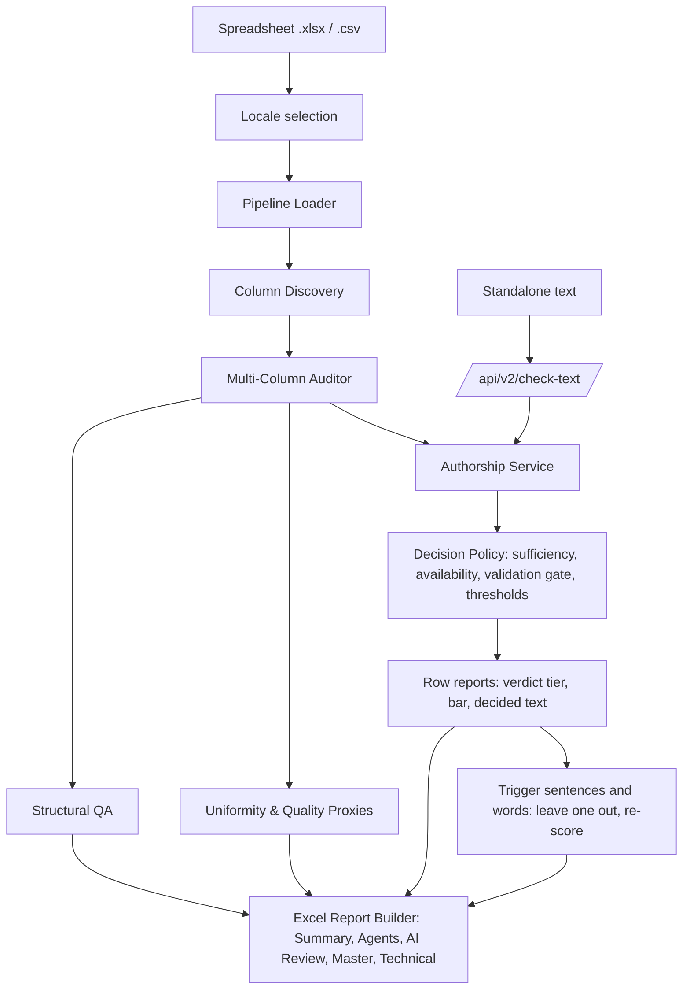

# Excel AI Text Detection & Structural QA Engine

[](https://www.python.org/downloads/)
[](LICENSE)

A Python engine for auditing human evaluation and RLHF annotation spreadsheets. It validates structural integrity, scores justification quality, checks text for likely LLM authorship, and exports multi-tab Excel workbooks with a human review workflow.

> **Status (2026-10-01): no model is validated, so by default the checker gives no decisive authorship labels.** On the fresh v4 locked test, neither the served `distilroberta-authorship-v5` nor the new Increment 4d models passed the gate (outcome `close_gate`). The 4d models are `deberta-v3-large-lora-authorship-4d`, plus a short-text model for 25–99 words. The served gate is closed, so the default `trained` provider returns `Inconclusive` with `MODEL_NOT_VALIDATED`.
>
> **The 4d models are better than v5, but not good enough to pass.**
> - They detect 37.8% of test AI against 24.5%, with about half the false AI: 35 of 20,730 human texts against 67.
> - Under 100 words, they detect 40.6% against 10.4%.
> - They fail two gated slices: No Robots false AI (5 of 553, 95% upper bound 1.89%) and missed AI on 2026 models in WasItAI (upper bound 19.7%).
> - They lose ground on older-generation text: HC3 by 31 points and MAGE by 14.
>
> See the [Increment 4d report](docs/bob/llm-authorship-checker/increment-4d-report-2026-10-01.md).
>
> **Unvalidated previews.** For review work, you can opt in to either model's verdicts with `preview-unvalidated` (the 4d model, the dashboard's default) or `preview-v5`. Verdicts use each model's calibrated thresholds. Every workbook and summary marks them `UNVALIDATED PREVIEW` and names the slices the model failed. Use them to route rows to human review, not as evidence.
>
> The legacy classifier's published accuracy was measured on a test set that overlaps its training data, so it is not a credible estimate ([details](docs/bob/llm-authorship-checker/legacy-performance-2026-09-26.md)).

---

## What it does

- **Three-way authorship decisions**: every checked text returns `Likely AI-generated`, `Likely human-written`, or `Inconclusive`, with reason codes, observed evidence, a score only when it is valid, and detector and policy versions. Short text, unsupported input, detector failures, an unvalidated model, and scores between the decision thresholds all return `Inconclusive`.
- **Same contract everywhere**: the standalone `/api/v2/check-text` endpoint and every spreadsheet use one shared decision policy (`src/detection/`).
- **Calibrated support gate**: before any decision, text must be English, long enough for a calibrated length band, and similar to the writing the model was calibrated on. Anything else returns `Inconclusive` with `UNSUPPORTED_LANGUAGE`, `UNSUPPORTED_LENGTH`, or `UNSUPPORTED_DOMAIN`.
- **Row-level spreadsheet checks**: a row's rationales are checked together as one text, which is usually long enough to judge. The cells are kept as supporting detail. Rater comments are *flag-only*: a row can be `Likely AI-generated` or `Inconclusive`, never `Likely human-written`, because no verified rater text exists to measure missed AI.
- **Model registry**: `models/registry.json` records the model's hash, calibration, and locked-benchmark history. The gate opens only when the benchmark passed and the files on disk match their recorded hashes. It is closed today.
- **Verdict tiers**: each audited row gets one verdict, which never changes a decision. See [The audit workbook](#the-audit-workbook).
- **Trigger sentences and words**: for a row with a high score, the audit finds the sentences and words whose removal takes away the largest share of the AI signal. Sentences appear in bold red inside the rationale, and words are underlined, with the effect of removing them (`Without it: 99% -> 97% (24% of the AI signal)`, `Words: "delve into" (18%)`). A sheet-wide Trigger Words table shows which words raise scores most often, and how many rows contain them.
- **Agents**: a per-agent table, most-flagged agents first, in the workbook and on the dashboard.
- **One locale at a time**: a workbook with a tab per locale (en_US, fr_FR, …), or a `locale` column, can be audited one locale at a time.
- **Structural QA**: blanks, invalid verdicts, duplicate rows, and cross-column rules.
- **Justification quality and inter-rater uniformity proxies.**
- **Column discovery**: automatically finds rater, rationale, verdict, and ID columns while skipping administrative and QC columns.
- **Local-first**: the default detector runs locally. Commercial detectors are optional, and their failures produce `Inconclusive`, never a decisive label. Trigger sentences and words never run on paid detectors.

An authorship decision is a risk assessment, not proof. Text alone cannot establish who wrote it; decisive results are meant to route items to human review.

---

## The audit workbook

An audit writes one `.xlsx` file with these sheets:

| Sheet | What it holds |
|---|---|
| **Summary Dashboard** | Run facts: model, locale, sheet, agent column, columns checked, rows, agents with any Likely AI, trigger sentences and words. Also the tier table with each tier's row count and measured rates, and notes. |
| **Agents** | One line per agent: rows, Likely AI, High AI score, Moderate, Not checked, highest score, share Likely AI. Most-flagged first. |
| **Trigger Words** | One line per trigger word or phrase across the sheet: rows it triggered, agents, average share of the AI signal, and how many of all rows contain it. Only when triggers ran. |
| **AI Review** | One line per row, strongest verdict first. Columns: Row #, Task ID, Agent, Verdict, AI Score, Bar, Decided On, the full Rationale with trigger sentences in bold red and trigger words underlined, Trigger, Each Column Alone. Two columns are left for the reviewer: Human Reviewer Decision (dropdown) and Reviewer Notes. |
| **Annotated Master** | The original sheet with 8–10 QA columns: QA Verdict, QA AI Score, QA Bar, QA Decided On, QA Trigger Sentence, QA Trigger Words, QA Quality Score, QA Quality Flags, plus structural issues and truncated columns when present. |
| **Technical** | One line per scored text (each cell, and the cells together): decision, score, bar, words, reason codes, evidence, versions, proxy warnings, and each sentence's and word's share of the AI signal. |
| **Structural Issues** | Only when the sheet has structural issues. |

**Verdict tiers.** *Likely AI* means the row cleared the calibrated bar for its length. The bar is shown beside every score. For 25–100 words, most rationales, the 4d model's bar is about 99%. Below the bar, rows are ranked in the sponsor's score bands, set in `TierConfig`. The rates below are for 25–100-word texts on the 4d model's validation data. That data is public writing, not rater text.

| Tier | Rule | Human texts landing here | AI texts landing here |
|---|---|---|---|
| Likely AI | cleared the calibrated bar | 0.04 in 100 | 34 in 100 |
| High AI score – review | 75% or more, under the bar | 6.4 in 100 | 57 in 100 |
| Moderate AI score | 50–75% | 4.9 in 100 | 3.1 in 100 |
| Needs a second look | 30–50% | 4.6 in 100 | 1.5 in 100 |
| Low AI score | under 30% | 84 in 100 | 3.9 in 100 |
| Not checked | no score, with the reason: not English, too short, too long, disguised characters, model not validated, and so on | – | – |

The rates live in `data/report/tier_rates.json`. Rebuild them from the saved calibration scores, with no GPU, after any recalibration or band change: `python -m src.report.tier_rates`. A model without measured rates shows "not measured for this model".

**Trigger sentences and words.** The audit drops one sentence at a time and re-scores the text with the same model. Then it drops one word at a time from the 3 sentences that matter most.
- **The measure:** shares are taken of the AI signal, the score's log-odds. Near the top of the scale a percent barely moves: 99% to 97% is a quarter of the signal.
- **Sentences:** up to 2 that each take away at least 20% of the signal. At most 12 are tried, each starting in the first 160 words.
- **Words:** up to 5 that each take away at least 5%, from at most 60 tried. Neighbouring trigger words are joined into a phrase and re-scored as one. Words too common to act on (the, and, is, …) are tried but never shown alone.
- **Trigger Words sheet:** a phrase that triggers in many rows and sits in most rows is likely shared wording, such as rubric terms, that the model over-reacts to.
- **Cost:** on a 250-row sheet with 205 high rows, triggers took about 3 minutes on the GPU (240 s audit, against 84 s without words).

Switch triggers off with the dashboard checkbox, `--no-triggers`, or `explain_triggers=false`. The settings are in `TriggerConfig`.

---

## Architecture Overview



---

## Directory Structure

```
excel-ai-qa-pipeline/
├── data/
│   ├── benchmark/v1..v4/        # corpus build records, test locks, bake-off, model and head-to-head records (no text)
│   └── report/tier_rates.json   # measured tier rates per model
├── models/                      # model registry (registry.json) and the legacy classifier
├── src/
│   ├── corpus/                  # corpus ingestion, generation, redaction, dedup, grouped splits, lock, audit
│   │   └── sources/             # one loader per dataset
│   ├── bakeoff/                 # model selection: candidates, folds, metrics, benchmarks
│   ├── authorship/              # registered model: training, calibration, support gate, registry, benchmark, head-to-head, speed
│   ├── detection/               # v2 contract, decision policy, authorship service (sealed scoring code)
│   ├── detectors/               # legacy trained detector, GPTZero, Originality.ai clients
│   ├── qa/                      # discovery, locales, structural checks, stylometry, proxies, quality
│   ├── report/                  # verdict tiers, tier rates, trigger sentences and words, row reports, Excel writer, summary
│   ├── integrations/            # Airtable sync client
│   ├── pipeline.py              # QA orchestrator
│   ├── cli.py                   # command-line interface
│   ├── api.py                   # FastAPI application
│   └── static/index.html        # web dashboard
├── scripts/                     # legacy dataset build and training scripts
├── docs/bob/                    # build brief, roadmap, debt ledger, pre-registrations, increment reports
├── docs/superpowers/            # design specs and implementation plans
├── tests/                       # pytest suite
├── handoff.md                   # current state and next steps for whoever picks this up
├── Dockerfile, compose.yaml     # non-root container
└── .github/workflows/ci.yml     # CI: tests + Docker build
```

---

## Quick start

```bash
git clone https://github.com/Prabal-eng/LLM-checker.git
cd LLM-checker
python -m venv .venv && .venv/Scripts/activate      # Windows; use source .venv/bin/activate elsewhere
pip install -r requirements.txt -r requirements-ml.txt   # install a CUDA build of torch for GPU use
```

The model weights are not in git (about 2.5 GB). Get the weights folder from the project owner, unzip it, and point `CORPUS_DIR` at it:

```bash
set CORPUS_DIR=C:\llm-authorship-corpus          # PowerShell: $env:CORPUS_DIR = "C:\llm-authorship-corpus"
python main.py                                    # opens http://localhost:8000
python main.py start --background                 # no terminal window
python main.py stop                               # stops a background checker
```

On the dashboard, upload a workbook, pick the **Tab** to audit, then run. A GPU is used when one is available.

## Getting Started

Requires Python 3.10+.

```bash
git clone https://github.com/inv-google/excel-ai-qa-pipeline.git
cd excel-ai-qa-pipeline
pip install -r requirements.txt
python -m pytest --cov=src --cov-report=term-missing
```

The tests need no GPU and no network. Training or scoring neural models additionally needs:

```bash
pip install -r requirements-ml.txt   # torch, transformers; install a CUDA build of torch for GPU use
pip install peft                      # only to train LoRA models (not yet in requirements-ml.txt)
```

Model weights and corpus text live outside the repo under `CORPUS_DIR` (default `D:/llm-authorship-corpus`). Without them, the `trained` provider returns `Inconclusive` for every text, and the previews refuse to start.

Or run in Docker:

```bash
docker compose up --build
```

---

## Usage

### CLI

```bash
python -m src.cli audit "evaluation_dataset.xlsx" -o "audited_report.xlsx"
python -m src.cli audit "evaluation_dataset.xlsx" --locale fr_FR -o "audited_fr_FR.xlsx"
python -m src.cli audit "evaluation_dataset.xlsx" -p preview-unvalidated --text-cols "Rationale A" "Rationale B"
python -m src.cli audit "evaluation_dataset.xlsx" --only-assigned --no-triggers --json
```

| Option | Meaning |
|---|---|
| `-p, --provider` | `trained` (default; the registered model, gate closed today), `preview-unvalidated` (4d), `preview-v5`, `heuristic`, `gptzero`, `originality` |
| `--locale` | Audit one locale: its tab if the workbook has one, else the rows whose `locale` column matches |
| `-s, --sheet` | A sheet by name (auto-detected if omitted) |
| `--text-cols` | The rationale columns to check (auto-detected if omitted) |
| `--rater-col` | The agent column (auto-detected if omitted) |
| `--only-assigned` | Skip rows without an assigned agent |
| `--no-triggers` | Skip trigger sentences and words |
| `--json` | Print the run summary as JSON |

Pick the rationale columns yourself when a sheet also holds an autorater's output: that text is AI-written by design, so checking it flags every row.

Optional commercial detectors (unvalidated, so always `Inconclusive`):

```bash
python -m src.cli audit "evaluation_dataset.xlsx" --provider gptzero --api-key YOUR_KEY
python -m src.cli audit "evaluation_dataset.xlsx" --provider originality --api-key YOUR_KEY
```

### Web dashboard and API

```bash
python -m uvicorn src.api:app --port 8000
```

Open `http://localhost:8000`:
1. Upload a spreadsheet.
2. Pick the model and, for a multi-locale workbook, the locale.
3. Confirm the detected columns, and leave trigger sentences and words on or switch them off.
4. Run the audit.

The page shows Likely AI, High AI score and Not checked counts, a table of flagged agents, the top trigger words, and a link to download the workbook.

| Endpoint | Purpose |
|---|---|
| `POST /api/inspect-columns` | Detected columns and locales for an uploaded file (form: `file`, optional `locale`) |
| `POST /api/audit` | Run an audit. Form fields: `file`, `provider`, `only_assigned`, `text_cols`, `locale`, `explain_triggers` |
| `GET /api/download/{filename}` | Download an audited workbook |
| `POST /api/v2/check-text` | Check one text |
| `GET /api/v2/health`, `GET /api/v2/metrics` | Health and decision counters |

Check standalone text. `context` is optional: `general` is the default, and `rater_comment` gives flag-only checks.

```bash
curl -X POST http://localhost:8000/api/v2/check-text \
  -H "Content-Type: application/json" \
  -d '{"text": "Paste the response to check here.", "context": "general"}'
```

---

## Authorship corpus

`src/corpus/` builds the labelled dataset used to select, calibrate, and evaluate detectors. Every sample carries a provenance record, and every build is audited.

```bash
python -m src.corpus.build              # download, ingest, redact, deduplicate, split, lock, audit
python -m src.corpus.audit --version v4 # re-audit the saved corpus independently; exit 1 on any violation
```

**Sources (v1, 276,153 samples after redaction and deduplication)**

| Source | Licence | Used for |
|---|---|---|
| MAGE | Apache-2.0 | Core human/AI text, 14 domains, 27 generators; paraphrase stress set |
| HC3 (English) | CC-BY-SA-4.0 | Human and ChatGPT answers to the same questions |
| RAID (train) | MIT | 8 English domains, 11 generators; adversarial-attack stress set |
| Beemo | MIT | Human, LLM, and expert- or LLM-edited LLM answers |
| MIRAGE | Pi-Lab 1.0 (non-commercial) | 17 recent generators (GPT-4o, Claude 3.5/3.7, Gemini 2.0, DeepSeek, Llama 3.1, Qwen 2.5); polish/rewrite stress set |
| Liang et al. essays | other-open | Non-native (TOEFL) and native student writers, evaluation only |
| Legacy in-house sheets | internal | Presumed-human rater text (evaluation only); template rows diagnostic only |

Every sample records its licence, so a licence class can be excluded by configuration.

**Storage.** Full text is written outside the repo under `CORPUS_DIR` (default `D:/llm-authorship-corpus`). Only build records and test locks (`data/benchmark/<version>/`) are committed; neither contains text.

**How a build is verified**

1. Every downloaded file's SHA-256 is recorded. Each record is validated on creation: licence and provenance are required, and AI samples must name their generator.
2. Emails, phone numbers, card numbers, and IP addresses are redacted until no pattern matches.
3. Exact duplicates are removed, and texts whose sources disagree on the label are dropped.
4. MinHash clustering groups near-duplicates. Samples sharing a prompt, source document, or cluster form one unit that never spans train, validation, and evaluation. Units containing stress or in-house samples go to evaluation, and three generator families are withheld from fitting to form an unseen-generator test.
5. The audit re-validates every row and **recomputes clusters from the stored text**. It fails on leakage, held-out families in training, PII, role/split violations, edited text, or any change to the evaluation splits.
6. The evaluation splits are fingerprinted. A build that would change them is refused unless run with `--relock "reason"`, which is recorded in the lock history.

v1 splits: train 99.7k, validation 20.8k, test 41.3k, unseen-generator 2.0k, stress 108.2k, in-house 3.8k, diagnostic 0.5k.

**Corpus v2 (308,194 samples)** adds Beemo and No Robots (human assistant-style answers) and AITA (same-title posts by seven 2026 models) to fitting. Dolly and OpenAssistant are held out whole as unseen human assistant-style test sources. rasbt/human-vs-ai-50k is diagnostic only because of shortcut artifacts. v1's locked test is retired and the buckets are re-drawn, so the v2 test is fresh. Records are in `data/benchmark/v2/`, and the pre-registration is in `docs/bob/llm-authorship-checker/increment-4b-preregistration.md`.

**Corpus v3 (260,337 samples)** adds 4,247 locally generated AI answers (six open models via Ollama) paired with Dolly, OpenAssistant and Stack Exchange prompts. Dolly and OpenAssistant are now fitted, with their v2 test groups retired. The fresh test draws on pre-ChatGPT Stack Exchange answers, with Phi-4-mini and Granite 4 held out as unseen generators. Test shares for AITA, No Robots and MIRAGE are raised to 35%. Containment dedup links near-copies. The model reads a format- and typography-neutral view of each text. Records are in `data/benchmark/v3/`; the pre-registration and its amendments are in `docs/bob/llm-authorship-checker/increment-4c-preregistration.md`.

**Corpus v4 (current)** retires every row an earlier model fitted or was tested on, and its near-duplicates.
- **New training sources:** MAGA, DACTYL, Arena 140k AI replies and OpenTuringBench AI news.
- **New test-only sources:** WasItAI (2026-09 models), LEDE frontier answers and eight new Stack Exchange sites.
- **Held-out generator families:** BigScience, Microsoft, IBM and TII.
- **More generated answers:** short answers, personas, plain text, a range of temperatures and humanized rewrites.
- **Load-time trims:** greetings, openers, self-announcing preambles and news template lines are removed.
- **The model view** (`format4`) drops every bullet glyph and numbered marker.

Records are in `data/benchmark/v4/`; the pre-registration and Amendments 1–16 are in `docs/bob/llm-authorship-checker/increment-4d-preregistration.md`. The v4 test is now spent.

## Model selection bake-off

`src/bakeoff/` compares candidate detectors **without reading any locked split**. The Parquet reader filters to train and validation, so the test, unseen-generator, stress, and in-house data stay untouched until the launch evaluation.

```bash
python -m src.bakeoff.run select --candidates legacy,tfidf,distilroberta,zs-fast-base,zs-fast-instruct,zs-binoculars
python -m src.bakeoff.run bench  --candidates tfidf,distilroberta,zs-binoculars   # CPU and GPU speed
bash scripts/run_bakeoff_supervised.sh <log> <candidates>   # rerun until success, resuming from fold checkpoints
```

Each candidate is scored on nine folds:

- **val**: in-distribution validation.
- **loso:&lt;source&gt;** (×4): fit and calibrate without one source, evaluate on it. This tests whether a model and its threshold carry over to a new kind of text.
- **lofo:&lt;family&gt;** (×3, Anthropic, DeepSeek, Google): fit without one generator family, evaluate on it.
- **recent:openai**: fit on older GPT models only, evaluate on GPT-4o, GPT-4o-mini, and o3-mini. OpenAI is 37% of the AI data, so it is never unseen as a family; the realistic risk is a new GPT version.

Metrics per fold: AUROC, detection rate at 1% and 0.5% false-positive rate with thresholds taken from calibration data only, the false-positive rate when that threshold transfers to the held-out fold (with a 95% upper bound), and AUROC by length bucket and source. Each finished fold is checkpointed, and transient CUDA faults are retried. Results are in `data/benchmark/v1/bakeoff/selection.json`.

**Result: DistilRoBERTa was selected in 2026-09.** Full report, decision matrix, and caveats: [docs/bob/llm-authorship-checker/model-selection-2026-09-26.md](docs/bob/llm-authorship-checker/model-selection-2026-09-26.md). Increment 4d later screened larger encoders within the 4 GB GPU, and DeBERTa-v3-large with LoRA won (Amendment 6 of the 4d pre-registration).

| Candidate | What it is | Val AUROC | Unseen source (worst) | Unseen family (mean) | Newest GPT | Detection at 1% FPR (val) |
|---|---|---|---|---|---|---|
| **distilroberta** | DistilRoBERTa fine-tuned on the corpus | **0.967** | **0.653** (MAGE) | **0.927** | **0.998** | **0.795** |
| tfidf | hashed word and character n-grams, linear classifier | 0.892 | 0.569 (MAGE) | 0.893 | 0.979 | 0.401 |
| zs-fast-instruct | zero-shot Fast-DetectGPT, Qwen2.5-0.5B instruct | 0.739 | 0.576 (MAGE) | 0.620 | 0.660 | 0.319 |
| zs-binoculars | zero-shot Binoculars, Qwen2.5-0.5B base and instruct | 0.735 | 0.558 (MAGE) | 0.622 | 0.658 | 0.185 |
| zs-fast-base | zero-shot Fast-DetectGPT, Qwen2.5-0.5B base | 0.704 | 0.576 (MAGE) | 0.570 | 0.571 | 0.256 |
| legacy | the shipped model, unchanged | 0.615 | 0.510 (MAGE) | 0.680 | 0.752 | 0.029 |

What the results show:
- The fine-tuned model generalizes to generators it never saw: 0.997 on unseen Anthropic, 0.999 on unseen DeepSeek, 0.998 on the newest GPT models.
- Zero-shot scoring falls below chance on unseen Claude text (0.39–0.48).
- **The main risk is unfamiliar writing, not unfamiliar generators.** On unseen MAGE text, a threshold set for 1% false positives elsewhere gives 10.8%. Calibration therefore checks every source slice, and the service returns `Inconclusive` outside the calibrated domains.
- **Short text is weak.** In-distribution AUROC is 0.83 under 50 words and 0.99 at 100+ words. A separate short-text model serves 25–99 words.

## Registered model: training, calibration, locked benchmark

`src/authorship/` turns a selected model into a registered, calibrated detector. Weights stay outside the repo under `CORPUS_DIR/models/`. Only records without text are committed.

```bash
python -m src.authorship.train --candidate deberta-v3-large-lora                    # main model
python -m src.authorship.train --candidate deberta-v3-large-lora --variant short    # 25-99-word specialist
python -m src.authorship.calibrate --candidate deberta-v3-large-lora               # validation only; targets 0.008 / 0.08
python -m src.authorship.speed --device cuda                                       # GPU and CPU limits
python -m src.authorship.headtohead --rerun-reason "..."                           # locked head-to-head; v4 is spent
```

- **Training:** source-balanced, on the format- and typography-neutral model view. The 4d models use DeBERTa-v3-large with LoRA, merged after training, in half precision.
- **Calibration:** thresholds are set per word-count band and shared across sources. Every source slice must keep its 95% upper bound on false AI within 0.8% and on missed AI within 8%. That leaves a margin under the release bounds of 1% and 10%.
- **Locked benchmark:** it runs once, with criteria fixed in the code before any result exists. It checks the corpus lock before reading. A rerun needs a recorded reason, and is only for bugs, never for tuning. A gated slice needs at least 300 humans (false-AI upper bound ≤ 1%) and 100 AI texts (missed-AI upper bound ≤ 10%), plus 40% supported coverage.
- **Sealed scoring code:** the registry records hashes of the scoring files (`src/detection/*.py`, `src/authorship/{detector,excerpts,language,registry,calibration}.py`, `src/corpus/text.py`, `src/detectors/base.py`). Editing one breaks the seal. Report code lives in `src/report/` and only imports from them.
- **Limits:** 4 GB GPU, 3.5 GB inference memory, a sheet within 900 s on the GPU (Amendment 16), and a CPU text within 20 s.

**Locked benchmark history**

| Date | Corpus | Model | Result |
|---|---|---|---|
| 2026-09-26 | v1 | distilroberta v1, v2 | fail: Beemo false AI |
| 2026-09-27 | v2 | distilroberta v3 | fail: Dolly, OpenAssistant, No Robots, AITA false AI |
| 2026-09-27/28 | v3 | distilroberta v4, then v5 (four runs) | **pass**: false AI 18 of 11,319, 65% of AI detected ([report](docs/bob/llm-authorship-checker/increment-4c-report-2026-09-28.md)) |
| 2026-10-01 | v4 | deberta-v3-large-lora 4d against v5 | **close_gate**: 4d fails No Robots and WasItAI; v5 fails MAGA, No Robots and WasItAI ([report](docs/bob/llm-authorship-checker/increment-4d-report-2026-10-01.md)) |

## Legacy classifier

`scripts/build_training_dataset.py` and `scripts/train_indomain_model.py` build and train the legacy classifier. They are kept as a baseline only. Their labels are largely template-generated and their splits leak duplicate text, so their metrics must not be used as a release gate. The verified corpus and locked benchmark above replace them.

---

## License

MIT License. See [LICENSE](LICENSE) for details.
